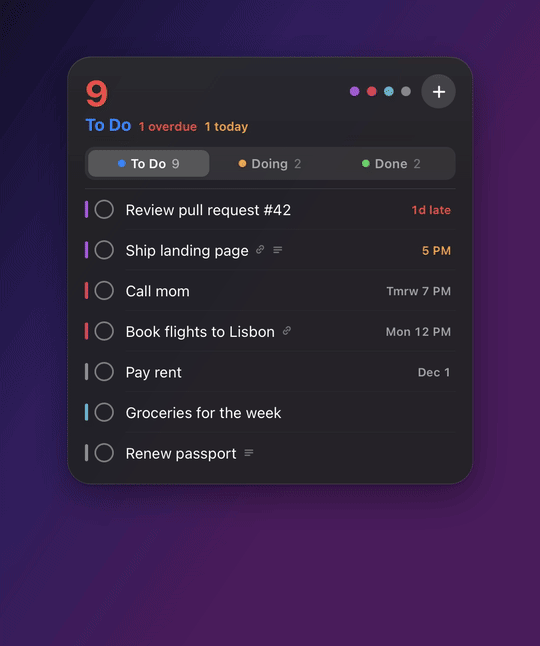
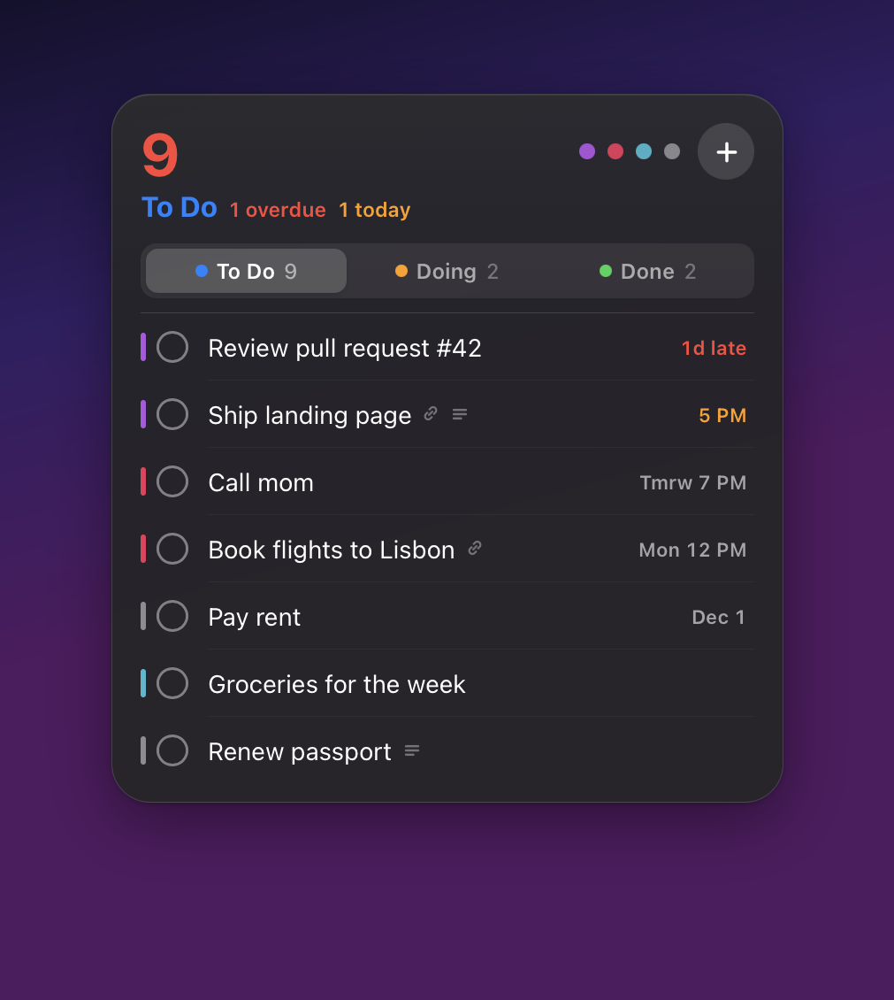
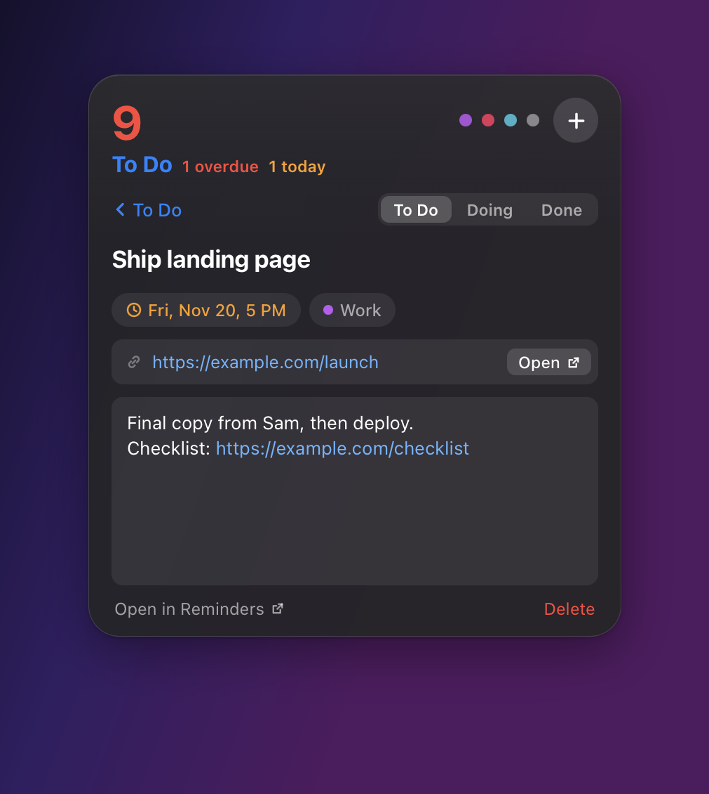
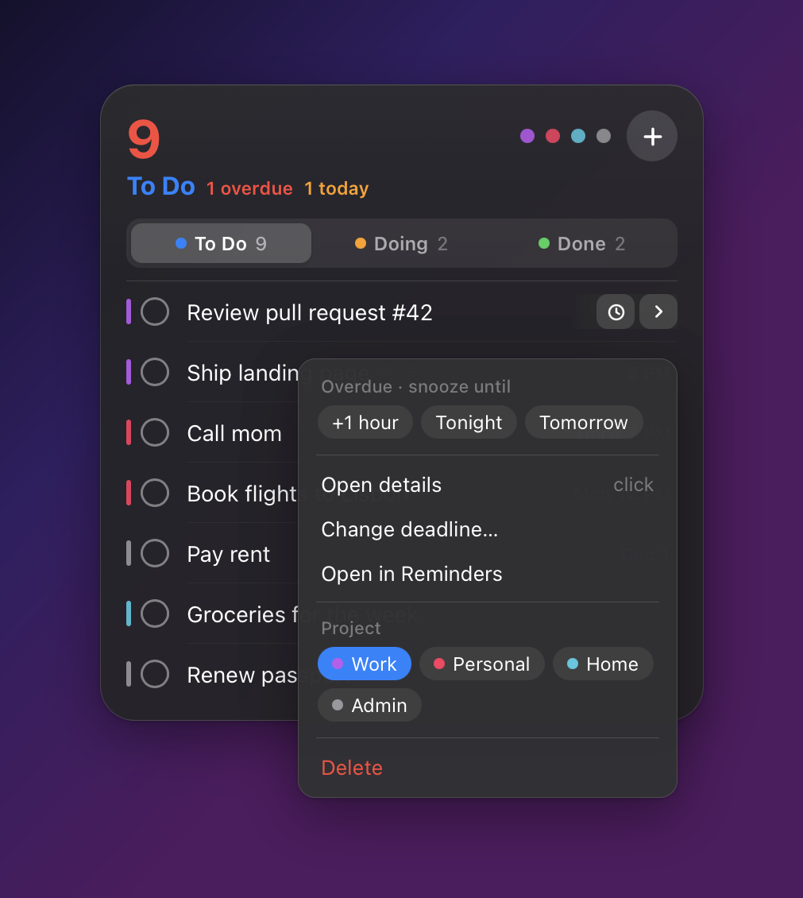
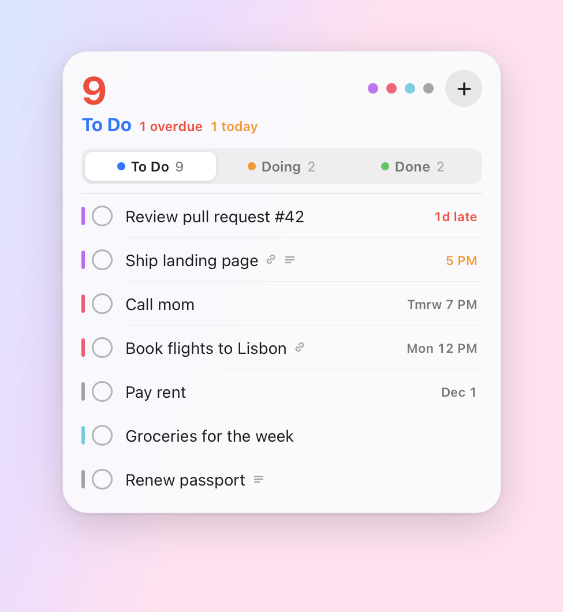
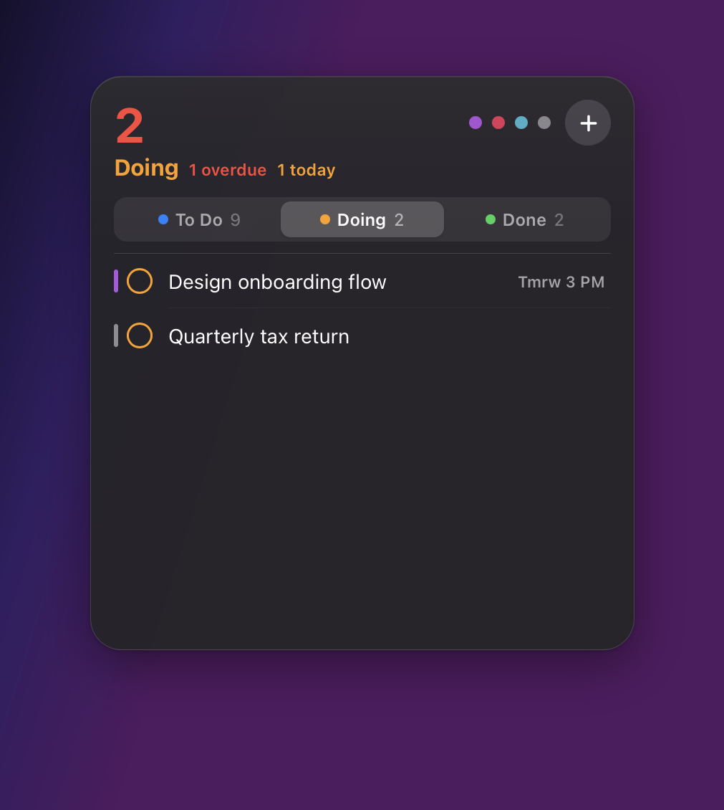
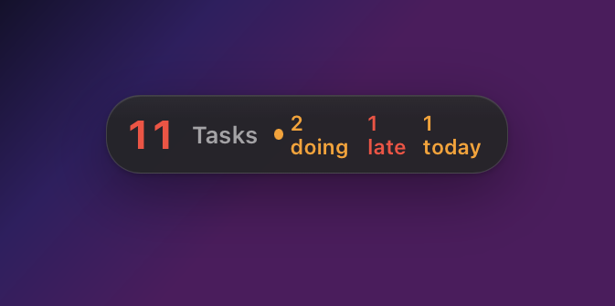

# Reminders Kanban

A compact, Apple-style **Kanban board for Apple Reminders** that lives on your Mac desktop,
and that your **AI assistant can add tasks to**.

Tell Claude *"add 'renew passport' for Monday 9am under Admin, note: bring the old passport and a photo"*
and it appears on your desktop a few seconds later, with the deadline, alert and description.
Everything is stored in Apple Reminders, so it's also on your iPhone, Apple Watch and in Siri.

<p align="center">
  
</p>

<table>
  <tr>
    <td align="center"><br><sub>Deadlines, projects, links and notes at a glance</sub></td>
    <td align="center"><br><sub>Click a task for details</sub></td>
    <td align="center"><br><sub>Right-click to snooze, set a project and more</sub></td>
  </tr>
  <tr>
    <td align="center"><br><sub>Follows light and dark mode</sub></td>
    <td align="center"><br><sub>To Do · Doing · Done</sub></td>
    <td align="center"><br><sub>Mini mode: click the big number</sub></td>
  </tr>
</table>

## Install

**Easiest: ask your AI.** If you use an assistant that can run commands on your Mac (Claude Code, Claude Desktop,
Cursor, Codex…), paste this:

> Install the Reminders Kanban widget from https://github.com/souljasec/reminders-kanban (follow its AGENTS.md)
> and connect it to yourself so I can add tasks by talking to you.

**Or run one command in Terminal:**

```bash
curl -fsSL https://raw.githubusercontent.com/souljasec/reminders-kanban/main/install.sh | bash
```

The installer:
1. installs [Übersicht](https://tracesof.net/uebersicht/) (the free app that shows desktop widgets) if needed,
2. builds a small native helper (needs Xcode Command Line Tools; it offers to install them),
3. asks once for access to your Reminders (click **Allow**),
4. connects **Claude Desktop**, **Claude Code** and **Codex** if you have them,
5. can start Übersicht at login, and finishes with a health check.

Run it again any time to update to the latest release (or ask your AI to "update Reminders Kanban").
Your tasks, projects, order and widget position are kept.

Requirements: macOS 14 Sonoma or newer.

## Features

- **To Do · Doing · Done** with a sliding tab switch. **Swipe left or right with two fingers** to switch columns
  (swipe right in a task's details to go back); drag a task onto a tab to move it
- **Drag to reorder** your tasks
- **Click a task for details**: title, status, deadline, project, link and description (links are clickable)
- **Deadlines with real notifications** on your Mac and iPhone. Quick picks: *Today · Tomorrow · This weekend · Next week*
- **Smart add**: `Pay rent tomorrow 3pm` sets the deadline for you, and ending with `!` puts it in Doing
- **Overdue and today** at a glance: red “2d late”, orange “3 PM”, plus a summary in the header
- **Undo** after every change, including delete
- **Right-click** to snooze, set a deadline, open the link, set a project, open in Reminders or delete
- **Project colours** with one-click filtering
- **Mini mode**: click the big number to fold it into a small pill
- Drag it anywhere: it **snaps to a grid** and **moves desktop icons out of the way**
- Smooth animations, and it follows macOS **light and dark** mode
- **AI connection (MCP)**: your assistant can list, add, update, move and complete tasks

## Talking to your AI

Once connected (restart Claude Desktop after installing), try:

- “Add a task: call the dentist tomorrow at 10am.”
- “Add ‘prepare pitch deck’ for Friday 5pm in Work, put it in Doing, link https://… and a note with the outline.”
- “What's overdue?” · “What am I working on?” · “Show my Work tasks this week.”
- “Move the pitch deck to Done.” · “Push the dentist to next Tuesday.”

The AI tools are `list_tasks`, `add_task`, `update_task`, `move_task` and `complete_task`.
**There is no delete tool on purpose**: AI can't remove your tasks. You delete them in the widget, where Undo exists.

### Connect other AI apps

Any app that supports MCP (Model Context Protocol) servers can use the helper. Point it at:

```json
{
  "mcpServers": {
    "reminders-kanban": {
      "command": "/Users/YOU/Library/Application Support/Reminders Kanban/reminders-kanban",
      "args": ["mcp"]
    }
  }
}
```

| App | How |
| --- | --- |
| Claude Desktop | automatic (`install.sh --claude-desktop`), then restart Claude |
| Claude Code | automatic (`install.sh --claude-code`) |
| Codex CLI | automatic if `codex` is installed (`install.sh --codex`) |
| ChatGPT desktop | may work through the Codex connection, depending on your ChatGPT version. ChatGPT on the web can't reach apps on your Mac. |
| Cursor, Windsurf, others | add the JSON above in the app's MCP settings |
| Siri / Apple Intelligence | works already: anything added to Reminders shows on the widget |

Windows and Linux aren't supported, because Apple Reminders only exists on Apple devices.

## How it maps to Reminders

| Column | Stored in Reminders as |
| ------ | ---------------------- |
| To Do  | open reminder |
| Doing  | open reminder with **high priority** (`!!!`) |
| Done   | completed (the last 3 days are shown) |

Deadlines are Reminders due dates with an alert and descriptions are its notes, so they show up in the Reminders
app and on your iPhone too. **Links** are added as the last line of the notes (`🔗 https://…`), where they're
clickable everywhere. Apple's Reminders app doesn't show links saved by other apps in its own URL field, so this is
the reliable way. Delete that line in Reminders and the link is removed from the widget too.
Apple doesn't let other apps read the flag or the Reminders sort order, so **Doing** uses high priority and your
**manual order** and **projects** are kept by the widget (see below).

## Customise

- **Projects** (names, colours, keywords used to guess a task's project) and your manual order live in
  `~/Library/Application Support/Reminders Kanban/data.json`. Edit the `projects` list, or just ask your AI to put a
  task in a new project and it's created automatically.
- **Size and behaviour**: `VISIBLE_ROWS`, `WIDTH`, `GRID` and `refreshFrequency` at the top of
  `~/Library/Application Support/Übersicht/widgets/kanban.widget/index.jsx`. Übersicht reloads it when you save.

## Troubleshooting

```bash
~/Library/Application\ Support/Reminders\ Kanban/reminders-kanban doctor
```

checks Reminders access, Übersicht, the widget and the AI connections, and tells you how to fix anything that's off.

- **“Can't reach Reminders”**: allow Übersicht (and your AI app) under System Settings → Privacy & Security → Reminders.
- **AI doesn't see the tools**: restart Claude Desktop after installing. In Claude Code, check with `claude mcp list`.
- **Widget gone after restart**: add Übersicht to System Settings → General → Login Items (or rerun the installer).

## Screenshots without your own tasks

To take screenshots or record a demo, create an empty file called `demo` in
`~/Library/Application Support/Reminders Kanban/`. While it exists, the widget and the AI tools only use a separate
Reminders list called **Kanban Demo** (created automatically), with its own projects file, so your real tasks never
appear. Delete the `demo` file to switch back.

## Uninstall

```bash
curl -fsSL https://raw.githubusercontent.com/souljasec/reminders-kanban/main/install.sh | bash -s -- --uninstall
```

This removes the widget, the helper and the AI connections. Your tasks stay in Apple Reminders.
Add `--purge` to also delete the projects and order data.

## Files

```
install.sh             installer / updater / uninstaller
AGENTS.md              install guide for AI assistants
kanban.widget/
├── index.jsx          the widget (React, rendered by Übersicht)
├── make-room.py       moves desktop icons out from under the widget
└── src/
    ├── bridge.swift   native helper: Reminders (EventKit) + MCP server + CLI + doctor
    └── Info.plist     lets macOS ask for Reminders access
```

The helper also works as a command-line tool: `reminders-kanban list | add | move | update | doctor | mcp`.

## License

[MIT](LICENSE). Free to use, change and share.

Übersicht is a separate open-source project by Felix Hageloh and isn't affiliated with this widget.
